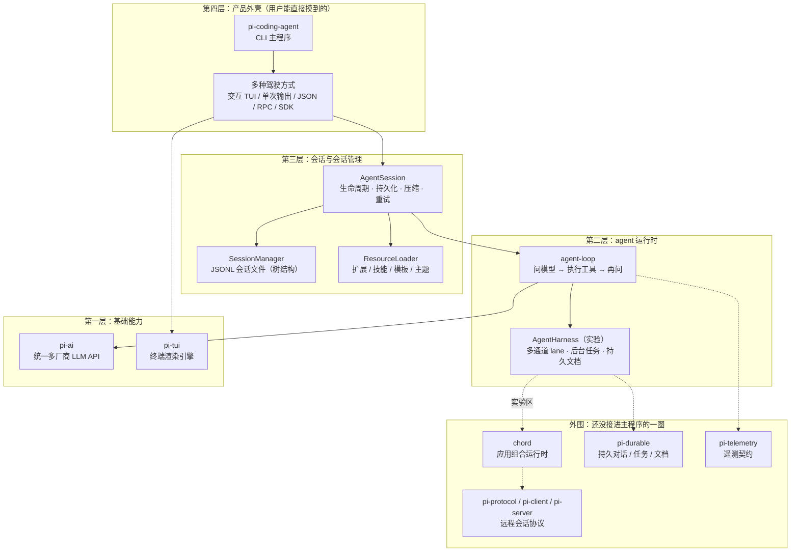
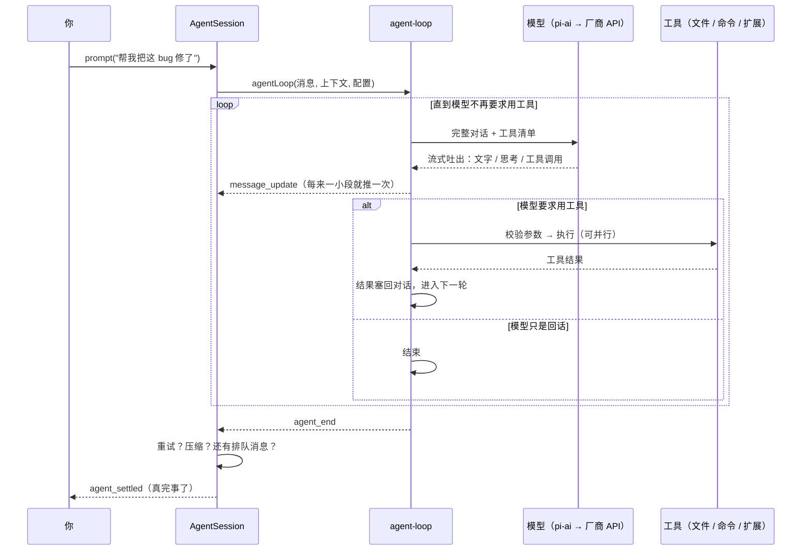

# pi-harness 核心架构

> 这份文档讲的是「pi 这个程序内部是怎么搭起来的」，面向想读懂源码、想改功能、或者单纯好奇「它凭什么能自己改代码」的人。
>
> 写法上刻意避开术语堆砌：每个概念先讲清「解决什么问题」，再讲「怎么做的」。读完你应该能回答三个问题——一个 prompt 从敲下回车到最后一条回答，中间经过了哪几站；每个包各自管什么；想改某个东西该去哪个文件。

---

## 一、先用一句话定位 pi

现在的大模型很会说，但它只会**说**。它读不了你的文件、跑不了你的命令、也不会记住昨天聊到哪儿了。

pi 就是补上这一段的那层程序：**把「会说的模型」接上「能干的手脚」，再把整件事记下来。**

具体来说，它干三件事：

| 它做的事 | 通俗解释 |
| --- | --- |
| 让模型能动手 | 给模型一套工具（读文件、写文件、跑命令、搜索），模型说「我要读 a.ts」，pi 就去读，再把结果喂回给模型 |
| 让模型有记忆 | 多轮对话、会话存档、上下文超长时自动摘要，关掉终端明天还能接着聊 |
| 让不同模型说同一种话 | OpenAI、Anthropic、Google、Bedrock……几十家厂商 API 各不相同，pi 把它们统一成一套事件格式 |

所以它在整条链路上的位置是：

```
   你  →  pi  →  大模型（云端或本地）
          ↕
     你的电脑：文件、命令、Git、终端
```

**关键认知：pi 自己不聪明。** 聪明的是模型。pi 的价值全在「怎么把模型的意图变成真实动作，并且不出乱子」——这一点决定了后面所有设计。

---

## 二、全局地图

pi-harness 是一个 TypeScript monorepo，`packages/` 下十来个包。别被数量吓到，它们其实是**四层 + 一圈外围**：



一句话总结这张图：**底下两层是「发动机」，第三层是「变速箱和行车记录仪」，第四层是「方向盘和仪表盘」。**

（构建顺序也是照这个依赖关系来的，见根 `package.json` 的 `build` 脚本：chord → tui → telemetry → ai → durable → agent → … → coding-agent。）

---

## 三、每个包到底管什么

| 包 | 一句话职责 | 打个比方 |
| --- | --- | --- |
| `pi-ai` | 统一多厂商 LLM API：模型目录、鉴权、把各家的流式响应翻译成同一套事件 | 同声传译 + 电话总机 |
| `pi-agent-core` | agent 运行时：那一圈「问模型 → 跑工具 → 把结果还给模型」的循环 | 工头，负责派活和收活 |
| `pi-coding-agent` | 产品本体：命令行参数、会话管理、扩展体系、多种运行模式、内置工具 | 一家公司，把工头、工具箱、档案柜、装修全组装起来 |
| `pi-tui` | 终端 UI 库：组件、输入处理、差分渲染 | 舞台监督，只重画变了的那几行 |
| `pi-telemetry` | 与厂商无关的遥测契约和类型化 schema | 统一的「体检表格式」 |
| `chord` | 应用组合运行时：插件（facet）、服务、复制状态、RPC | 一套通用的「零件装配台」 |
| `pi-durable` | 持久化的对话 / 任务 / 文档运行时 | 可恢复的账本 |
| `pi-protocol` / `pi-client` / `pi-server` | 用 CBOR 分帧传输的远程会话协议、客户端、服务端 | 远程遥控器的对讲协议 |
| `pi-evals` | 评测工具 | 考试卷 |
| `session-backends/sqlite-node` | SQLite 会话存储后端 | 另一种档案柜 |

**为什么 `pi-ai` 要单独拆出来？** 因为「供应商」和「协议」是两件事。

- 一个**供应商**（provider）是「谁提供服务」：Anthropic、OpenAI、DeepSeek、OpenRouter、Bedrock……
- 一个**协议**（api）是「你们用哪种话术对话」：`anthropic-messages`、`openai-completions`、`openai-responses`、`google-generative-ai`……

一个供应商可以用某一种协议，也可以用好几种；同一个协议又能被十几家供应商复用（很多国产模型都兼容 `openai-completions`）。所以代码里是两层映射：provider → api 实现 → 统一事件。

另外两个细节值得知道：

- **模型目录是构建时生成的**（`packages/ai/src/models.generated.ts`），来源是各家线上 API；改模型信息要改生成脚本 `scripts/generate-models.ts`，不能手改生成物。用户想加自定义模型，写 `~/.pi/agent/models.json`，不用碰源码。
- **供应商模块是懒加载的**（`api/*.lazy.ts`），不用 Anthropic 就不加载 Anthropic 的 SDK，启动快。

---

## 四、一次对话的完整旅程

下面这条线，是从你敲 `pi` 回车到看见回答的全过程。

### 4.1 启动：把零件装起来

`packages/coding-agent/src/main.ts` 最先跑，做四件事：

1. **解析参数、跑迁移**（老版本配置文件升级）。
2. **装配当前目录相关的服务**（`createAgentSessionServices`）：三样东西——
   - `ModelRuntime`：读 `~/.pi/agent/auth.json`（凭证）和 `models.json`（自定义模型）；凭证优先用 `auth.json` 里存的那份，**只有没存的时候才去看环境变量**（避免「存过 key 却悄悄用了另一把」这种难查的错）；
   - `SettingsManager`：全局 `~/.pi/agent/settings.json` 与项目 `.pi/settings.json` 深合并，项目优先；
   - `DefaultResourceLoader`：扫描扩展、技能、提示模板、主题、`AGENTS.md` 等项目上下文文件。
3. **决定用哪个模型、什么思考强度**：命令行参数 → 会话里存的 → 设置里的默认 → 第一个可用的，逐级回退；思考强度还会按模型能力夹取（模型不支持 `high` 就自动降）。
4. **建 `AgentSession`**（`createAgentSession`）：把 `Agent`（运行时）、工具集、会话文件、扩展全部接好，然后把方向盘交给某一个模式（交互 / 单次 / RPC）。项目级资源要等「项目是否被信任」确认后才加载——这是安全边界。

### 4.2 准备上下文：模型的「说明书」怎么拼出来

模型每次请求都看不到历史，它只能看到你**这一次发给它的全部文本**。所以 pi 要把「系统提示 + 项目规则 + 技能清单 + 历史对话」拼成一份完整的稿子。

系统提示（system prompt）的组成，从上到下：

| 段落 | 内容 | 来源 |
| --- | --- | --- |
| 基础提示 | 角色、工作方式、安全约定 | 内置默认提示 |
| 工具说明 | 每个启用工具的用法和注意事项 | 各工具的 `promptSnippet` / `promptGuidelines` |
| 追加提示 | 用户自己写的补充规则 | `APPEND_SYSTEM.md`、设置项、扩展 |
| 项目上下文 | `AGENTS.md` / `CLAUDE.md` 等 | 从当前目录往上找，命中第一个就停 |
| 技能索引 | 每个技能的**名字、一句描述、文件路径** | 扫描到的技能（正文不进来） |
| 工作目录 | 告诉模型它在哪个目录干活 | 运行时 |

这里有个很值得一提的设计：**技能正文从不预先塞进提示。** 提示里只有一个目录，模型判断「这活我会」时才用 `read` 工具去读 `SKILL.md`。这就是所谓「渐进披露」——一百个技能也不会把上下文撑爆，代价是模型得多花一步读取。

### 4.3 一轮对话：那个著名的循环

「一轮」（turn）的定义是：**模型回一次话 + 它要求的工具全部跑完。** 一次 agent 运行可能包含很多轮。



几个容易踩错、但设计上很讲究的点：

**① 两条消息队列。**
模型干活时你还能打字，这些字不会丢：

- 回车 = 转向消息（steering）：当前这一轮工具跑完就插进去，等于半路改需求；
- Alt+Enter = 后续消息（follow-up）：等它把手头活全干完再说；
- Esc = 中断，排队里的消息会退回编辑器。

**② 工具结果反过来成了下一轮的输入。**
这就是 agent 和聊天机器人的本质区别：模型不是「一次答完」，而是「说一句、做一件、看一眼结果、再决定下一步」。

**③ 一轮结束不等于运行结束。**
`agent_end` 只是「这一趟循环跑完了」。之后 `AgentSession` 还会检查：是不是可重试的错误？上下文是不是该压缩了？刚结束时有扩展塞了新消息吗？三样都排除了，才发 `agent_settled`——**这个事件才是「真的全干完了」**。

### 4.4 工具执行：这一段最容易出事，也最讲究

模型说「我要调用 `edit`，参数是……」时，pi 并不盲信：

1. **校验参数**：每个工具用 TypeBox 声明参数结构，收到的 JSON 必须过一遍 schema，不合规直接变成一条错误结果还给模型，不执行。
2. **截断保护**：如果这次回答是被 token 上限硬截断的（`stopReason: "length"`），消息里的工具参数很可能是残缺的——这一批工具**一个都不执行**，全部回报失败，免得拿着半截参数去删文件。
3. **前钩子**：`beforeToolCall` 可以拦截（`block`），扩展可以在这里做权限判断、改参数。
4. **执行**：默认**并行**（同一批里的多个工具同时跑），但工具可以声明自己是 `sequential`；编辑类工具还有一把「同一文件互斥锁」（file mutation queue），防止两个写入互相踩。
5. **后钩子**：`afterToolCall` 可以整体替换结果内容、标错、打上「本批跑完就收工」的终止标记。
6. **结果入账**：工具结果作为 `toolResult` 消息进入对话，同时立刻写进会话文件。

内置工具就四个：`read`、`bash`、`edit`、`write`（另有 `grep`、`find`、`ls`、Windows 的 `powershell` 等可选）。**其余能力全部靠扩展加**——这是 pi 的核心取舍：核心保持小。

### 4.5 收尾：自愈与记忆

一次循环结束后，`AgentSession` 还有两条「自愈通道」：

- **重试**：网络抖、限流、5xx 这类可恢复错误，按退避策略重试（次数和延迟可配）。
- **压缩**：估算上下文 token 超过「窗口 - 保留量」时，把老对话总结成一段摘要，只保留最近的工作现场，然后继续。

都没问题后，这一轮的每个消息其实早就在 `message_end` 时**逐条追加**进会话文件了——不是最后一次性保存，所以中途崩溃也不会丢掉前面聊的。

---

## 五、四个关键设计，理解了就理解了大半

### 5.1 两套消息类型：给模型看的，和给自己记的

pi 内部的消息（`AgentMessage`）比模型能吃的消息（`Message`）更丰富：

| 内部消息 | 模型能看到吗 | 用途 |
| --- | --- | --- |
| `system` / `user` / `assistant` / `toolResult` | 能 | 标准对话 |
| `bashExecution`（`!` 命令） | 能（`!!` 除外） | 你手敲的命令和输出 |
| `custom`（扩展注入） | 看 `display` 与转换规则 | 扩展往对话里塞内容 |
| `compactionSummary` / `branchSummary` | 能（包成摘要文本） | 压缩与分支摘要 |

**只在调用模型的那一刻做转换**（`convertToLlm`）。好处是：会话文件能存下比模型上下文更丰富的东西（比如被 `!!` 标记为「别给模型看」的命令输出），而模型那边永远只收到干净的四种角色。

另一个反直觉的设计：**系统提示本身就是对话里的一条 `system` 消息，工具清单也挂在它身上。** 所以工具集变化时，pi 不是偷偷改参数，而是往对话里插一条新的 `system` 消息，明确写「新增了哪些工具、移除了哪些工具」（`toolsAdded` / `toolsRemoved`）。这样整段对话是自解释的、可回放的：重放一遍历史，就能还原出当时模型看到的工具清单。

### 5.2 会话文件是一棵树，不是一条线

打开 `~/.pi/agent/sessions/--<路径>--/<时间戳>_<id>.jsonl`，你会看到一行一个 JSON 对象。重点是每条记录都有 `id` 和 `parentId`：

```
   [你: 第一句]  ←── parentId: null
        │
   [模型: 回答]  ←── parentId: 上一条的 id
        │
   [你: 第二句]
        ├──────────────┐
   [模型: 方案A]     [模型: 方案B]   ← 两条都指向同一个父节点
        │
   [工具: 改文件]
```

- 因为记的是「父指针」而不是「第几行」，**分支不产生新文件**：想换个方向重来，新建一个子节点就行，原来的分支还在。
- `/tree` 就是在树上跳；从老节点继续会生成一条新分支。
- **压缩和分支摘要也是节点**（`compaction`、`branch_summary`）。重建上下文时，从当前叶子沿父链往上走，遇到压缩节点就用「摘要 + 它标记的保留起点之后的消息」拼回来。

这个设计的代价是：读会话文件的人得理解树，不能傻乎乎从头读到底；换来的是**历史完整可回溯**，任何一次「如果当时那样问会怎样」都不会丢。

### 5.3 上下文压缩：给长对话做减法

模型有上下文上限，聊久了必然塞满。pi 的规则很朴素：

```
当前估算 token 数 > 上下文窗口 - 预留量（默认 16k，留给回答）
        ↓
从最新的消息往回数，凑够「保留量」（默认 20k）
        ↓
更早的部分交给模型总结成结构化摘要
        ↓
会话里插一条 compaction 节点：摘要 + 从哪条消息开始保留
        ↓
重建上下文：摘要 + 保留的消息
```

触发时机有三处：一轮工具跑完后、新 prompt 之前、一次运行结束后。另外还有一种兜底——如果模型直接报「上下文超限」，也会立刻压缩再重来一次，但**每条用户输入只给一次这样的自动补救机会**（计数在你下次输入时重置），避免压缩了还是超、超了又压缩的死循环。

手动 `/compact [附带要求]` 是同一套机制，只是你指定了摘要的侧重点。

### 5.4 事件流驱动：一个内核，五种外壳

`agent-loop` 对外只做一件事：**不停往外抛事件**。

```
agent_start → turn_start → message_start → message_update × N → message_end
            → tool_execution_start → tool_execution_update × N → tool_execution_end
            → turn_end → (下一轮…)
            → agent_end
```

谁订阅都行，谁不订阅也不影响它跑。于是同一套内核可以配五种外壳：

| 模式 | 谁在订阅 | 适用场景 |
| --- | --- | --- |
| 交互模式（默认） | TUI 渲染器 | 人坐在终端前用 |
| 单次模式 `-p` | 直接打印最终结果 | 脚本、管道 |
| JSON 事件模式 `--mode json` | 把事件序列化成 JSONL | 给别的程序吃 |
| RPC 模式 | stdin/stdout JSON 协议 | 嵌进编辑器插件、自定义前端 |
| SDK | 你自己的代码 | 写自己的产品 |

这也是为什么扩展能插手这么多环节：扩展拿到的也是同一批事件（外加一批「之前」钩子，比如 `tool_call`、`before_agent_start`、`session_before_compact`），想改结果就返回修改值。

---

## 六、扩展体系：常驻代码 vs 按需手册

pi 的自定义能力分五种，新手最容易混的是 extension 和 skill 的区别：

| 类型 | 本质 | 什么时候加载 | 类比 |
| --- | --- | --- | --- |
| **扩展（extension）** | 一段 TypeScript/JS 代码，进程内运行 | 启动时全加载 | 给公司装的新部门，随时待命 |
| **技能（skill）** | 一份 `SKILL.md` 说明书（可带脚本） | 只加载「名字 + 描述」，正文按需读 | 员工手册，用到才翻 |
| **提示模板（prompt template）** | 预先写好的提示词 | 输入 `/名字` 时展开 | 快捷短语 |
| **主题（theme）** | 颜色方案 | 渲染时用 | 换壁纸 |
| **pi 包（package）** | 上面几样的打包分发单位 | 安装后按声明加载 | 应用商店里的套装 |

**扩展能干什么**（`pi.registerXxx` 一族 API）：

- `registerTool` 加工具、`registerCommand` 加斜杠命令、`registerShortcut` 加快捷键；
- 订阅三十多种事件（会话、轮次、消息、工具、模型切换、输入……）；
- 接管 UI：自定义对话框、选择器、状态行、渲染方式；
- 拦截并改写：模型请求头、请求体、工具参数、工具结果、系统提示、上下文。

**扩展的扫描顺序**：项目 `.pi/extensions/` → 全局 `~/.pi/agent/extensions/` → 设置里显式配置的路径 → 安装的 pi 包 → `--extension` 命令行指定。它们**不是互相覆盖的关系**，而是全部加载、各干各的；只有在你注册了同名工具或同名命令时，才有「谁最后生效」的问题。

**技能扫描位置**：全局 `~/.pi/agent/skills/`、`~/.agents/skills/`；项目 `.pi/skills/`、`.agents/skills/`（含祖先目录）；以及包、设置、命令行。技能按名字去重：重名会报冲突诊断，保留先加载的那个，而不是悄悄覆盖。

**安全边界很重要**：扩展是**任意代码**，技能是**任意指令**。所以项目级资源不自动加载——要你先确认「信任这个项目」，因为克隆一个陌生仓库就让它的扩展跑起来等于直接交出整台机器。pi 本身也不内置权限系统，需要更强隔离就得容器化（见 `packages/coding-agent/docs/containerization.md`）。

---

## 七、终端界面为什么不闪

终端不像浏览器有 DOM，每次重画整屏会闪得没法用。`pi-tui` 的做法是：

1. 组件树各自 `render()` 出文本行；
2. 和上一帧**逐行比对**，只把变化的行推给终端；
3. 用 CSI 2026「同步输出」把一次更新包成原子操作，避免撕裂；
4. 主屏幕和备用屏幕两套渲染器共用同一套接口（备用屏支持鼠标滚动、应用自己管滚动位置）。

配套的还有一堆细节：宽字符（中文、emoji）宽度计算、括号粘贴模式、终端图片协议（Kitty / iTerm2）、按键匹配与自定义键位。

---

## 八、那片还在长的实验区

仓库里有一条**没接进主程序**的技术线，看名字容易误解，先说清楚：

| 位置 | 是什么 | 现在什么状态 |
| --- | --- | --- |
| `packages/agent/src/harness/` | `AgentHarness`：把会话拆成多条「车道」（lane，主对话 / 后台 / 待办各一条），支持排队、挂起、中断、恢复、分支、压缩、技能、模板 | 可用，但主 CLI 不走它 |
| `packages/coding-agent/src/experimental/` | 多进程版的客户端 / 服务端 / worker / 协调器 | 实验，产物发布时被排除（`files` 里 `!dist/experimental`） |
| `packages/chord` | 应用组合运行时：插件、服务、复制状态、远程绑定 | 独立可用，被实验区使用 |
| `packages/protocol` `client` `server` | CBOR 分帧的远程会话协议与两端实现 | 代码完整但不是主程序路径（`pi-server` 自述为 experimental），主 CLI 不走 |
| `packages/durable` | 持久对话 / 任务 / 文档 | 接口已成型，目前只有内存存储实现，尚未接入主 CLI |

**为什么要留着这套东西？** 因为「一个终端里的单进程 agent」只是形态之一。要支持「一个会话跑在服务器上，多个前端同时看」「后台长任务跑着、前台继续聊」「断线重连不丢状态」，就得把状态、事件、RPC 都抽出来——`AgentHarness` + `chord` + CBOR 协议就是为这个准备的。

**但要诚实**：主路径（`pi` 命令）今天走的还是 `AgentSession` 那一条。实验区的代码不进发布产物，接口也不保证稳定。看架构时把它当「未来分支」，别当现状。

---

## 九、设计取舍：这套架构的代价

没有免费的设计。pi 这几个选择各有明确代价：

| 选择 | 好处 | 代价 |
| --- | --- | --- |
| 核心保持小，能力靠扩展 | 启动快、代码少、好审计 | 开箱功能有限；扩展质量参差；扩展是任意代码，风险自负 |
| 不内置权限系统 | 简单、可预测、不挡路 | 需要隔离得自己上容器 / 沙箱 |
| 会话是「树」不是线 | 历史完整、随时分支 | 文件格式复杂，第三方工具要理解树 |
| 系统提示写进对话 | 可回放、工具变更显式 | 每次请求要带完整 system 消息，token 开销略高 |
| 消息逐条落盘 | 崩溃不丢历史 | 大量小写入；会话文件会很长 |
| 技能按需读取 | 上下文不被撑爆 | 多一步读取；描述写得差就不会被触发 |
| 多厂商统一抽象 | 换模型几乎无感 | 厂商特有能力要走「透传选项」，抽象层得不断追新 |

---

## 十、想改代码？先看这几个文件

| 你想改的东西 | 从哪儿入手 |
| --- | --- |
| agent 的循环逻辑（什么时候停、怎么调工具） | `packages/agent/src/agent-loop.ts` |
| 循环的配置项和钩子（`AgentLoopConfig`） | `packages/agent/src/types.ts` |
| 会话事件 → 持久化 / 压缩 / 重试 | `packages/coding-agent/src/core/agent-session.ts` |
| 建会话时的装配流程 | `packages/coding-agent/src/core/sdk.ts`、`core/agent-session-services.ts` |
| 会话文件格式、树、分支 | `packages/coding-agent/src/core/session-manager.ts` |
| 系统提示怎么拼 | `packages/coding-agent/src/core/system-prompt.ts` |
| 资源扫描（扩展 / 技能 / 模板 / 主题） | `packages/coding-agent/src/core/resource-loader.ts` |
| 扩展 API 和事件类型 | `packages/coding-agent/src/core/extensions/types.ts` |
| 扩展怎么被调用 | `packages/coding-agent/src/core/extensions/runner.ts` |
| 内置工具 | `packages/coding-agent/src/core/tools/` |
| 厂商适配 | `packages/ai/src/api/`、`packages/ai/src/providers/` |
| 模型目录 | `packages/ai/scripts/generate-models.ts`（生成物别手改） |
| 终端渲染 | `packages/tui/src/tui.ts`、`tui-main-screen.ts`、`tui-alt-screen.ts` |
| 交互模式的界面逻辑 | `packages/coding-agent/src/modes/interactive/` |

---

## 十一、术语速查

| 术语 | 这里的含义 |
| --- | --- |
| **turn（轮）** | 模型回一次话 + 它要求的工具全部执行完 |
| **run（运行）** | 从一次 prompt 开始，到模型不再要求工具为止，中间可能有很多轮 |
| **steering / follow-up** | 干活途中插话（本轮结束生效）/ 干完再说的后续消息 |
| **compaction（压缩）** | 把老对话总结成摘要，腾出上下文空间 |
| **branch summary（分支摘要）** | 从别的分支切回来时，把那条分支的经过总结一段带过来 |
| **lane（车道）** | 实验区概念：一个会话里并行的多条独立对话线（主对话 / 后台 / 待办） |
| **provider / api** | 谁提供服务 / 用哪种协议说话 |
| **facet / service（chord）** | 插件的一个可独立部署的切片 / 有类型的服务契约 |
| **extension / skill** | 常驻的代码插件 / 按需加载的说明书 |

---

## 附：一张图收尾

```
你按下回车
   │
   ▼
┌──────────────────────────────────────────────────────────────┐
│  pi-coding-agent：解析输入 → 拼系统提示 → 交给 AgentSession   │
└──────────────────────────────────────────────────────────────┘
   │  ① 完整对话 + 工具清单
   ▼
┌──────────────────────────────────────────────────────────────┐
│  pi-agent-core：循环                                          │
│    问模型 ──▶ 收到「我要用工具」 ──▶ 校验/执行 ──▶ 结果入账   │
│       ▲                                            │          │
│       └────────────────────────────────────────────┘          │
└──────────────────────────────────────────────────────────────┘
   │  ② 每一步都通过事件流出
   ▼
┌──────────────────────────────────────────────────────────────┐
│  pi-tui / 你的程序：只重画变化的部分，其余保持不动             │
└──────────────────────────────────────────────────────────────┘
   │  ③ 每条消息落进 JSONL 树，超长就压缩，出错就重试
   ▼
  下次打开 pi，接着上回说
```

**记住这条主线就够了：模型负责想，pi 负责「把它想的变成真的」，会话文件负责记住发生过什么。**
